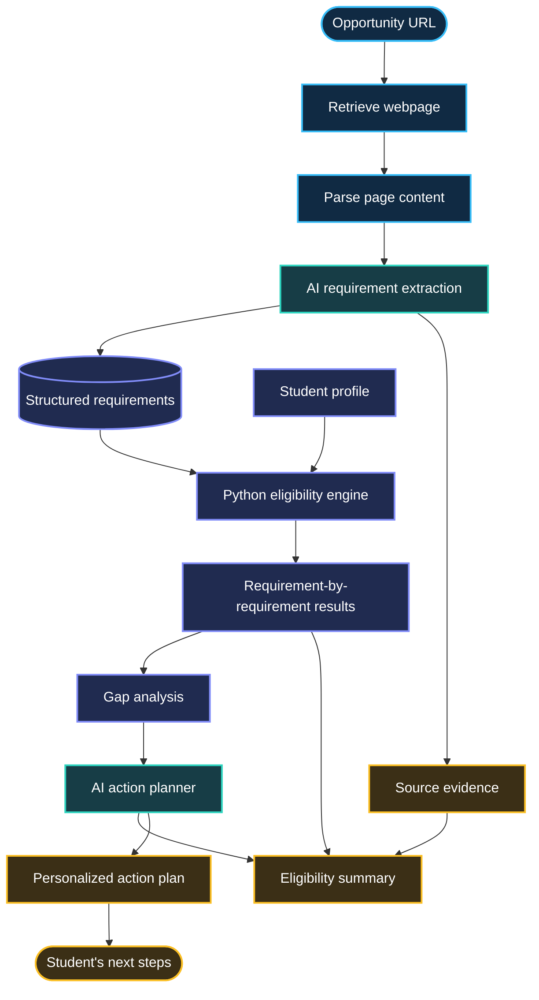
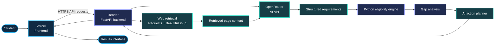

<div align="center">

# 🧭 NAVIGATE

### FROM OPPORTUNITY TO ACTION

**AI-Powered Opportunity Eligibility & Action Planning**

Turn opportunity requirements into eligibility insights, requirement gaps, and a practical plan for what to do next.

<br>

[**↗ OPEN LIVE DEMO**](https://navigatee.vercel.app/)

<br>

`AI REQUIREMENT EXTRACTION` · `PYTHON RULE ENGINE` · `PERSONALIZED ACTION PLANNING`

</div>

---

## ✦ The idea behind NAVIGATE

Finding an opportunity is one thing. Knowing whether you qualify is another.

Internships, scholarships, fellowships, and student programs often have requirements scattered across lengthy webpages. Students must interpret those requirements, compare them against their own profiles, identify missing qualifications, and decide what to do next.

**NAVIGATE brings those steps into one structured workflow.**

Provide an opportunity URL and your academic profile. NAVIGATE extracts available requirements, evaluates them against your profile, identifies gaps, and generates a personalized action plan.

> **Not just “Am I eligible?” — but “Why, and what should I do next?”**

<div align="center">

| 🔎 UNDERSTAND | ⚖️ EVALUATE | 🧩 IDENTIFY | 🧭 ACT |
|:---:|:---:|:---:|:---:|
| Extract requirements | Apply Python rules | Find requirement gaps | Generate next steps |

</div>

## 🚀 Try it

<div align="center">

### Your next opportunity, made clearer.

[**OPEN NAVIGATE →**](https://navigatee.vercel.app/)

Explore the live application to see the workflow in action.

</div>

---

## 🧠 The engineering idea that makes NAVIGATE different

NAVIGATE separates language understanding from eligibility decisions.

Rather than asking a language model to decide everything in one step, the system uses different components for different jobs.

```text
        OPPORTUNITY WEBPAGE
                 │
                 ▼
       ┌───────────────────┐
       │   AI EXTRACTOR    │
       │ Understands text  │
       └─────────┬─────────┘
                 │
                 ▼
       ┌───────────────────┐
       │ STRUCTURED DATA   │
       │ Requirements      │
       └─────────┬─────────┘
                 │
                 ▼
       ┌───────────────────┐
       │ PYTHON RULE ENGINE│
       │ Evaluates profile │
       └─────────┬─────────┘
                 │
                 ▼
       ┌───────────────────┐
       │   GAP ANALYSIS    │
       │ Missing criteria  │
       └─────────┬─────────┘
                 │
                 ▼
       ┌───────────────────┐
       │   AI ACTION PLAN  │
       │ Practical next steps
       └─────────┬─────────┘
                 │
                 ▼
       ┌───────────────────┐
       │ RESULTS + EVIDENCE│
       └───────────────────┘
```

### AI interprets. Python decides. AI plans.

- **AI interprets:** extracts requirements from retrieved opportunity content.
- **Python evaluates:** applies deterministic rules to the structured requirements and student profile.
- **AI plans:** turns identified gaps into actionable preparation guidance.

This separation makes the evaluation logic more inspectable than relying on a single unconstrained AI-generated yes/no answer. Its reliability still depends on correct requirement extraction, appropriate rules, and accurate source information.

---

## ⚙️ How the system works



### 01 · Opportunity retrieval

The application accepts an opportunity URL and attempts to retrieve its webpage content.

The retrieval layer uses Python's `Requests` library, while `BeautifulSoup` parses the returned HTML.

### 02 · AI requirement extraction

AI processes the retrieved content to identify eligibility criteria and convert them into structured requirements.

Examples include:

- Minimum CGPA
- Eligible degree or field of study
- Academic year or graduation status
- Required skills
- Other stated conditions
- Requirements needing clarification

### 03 · Deterministic eligibility evaluation

The Python eligibility engine compares extracted criteria with the student's profile.

Where a requirement can be evaluated using available information and a defined rule, the engine can return a structured result. Unknown, ambiguous, or conditional criteria should not automatically be treated as satisfied.

### 04 · Gap analysis

NAVIGATE identifies which requirements appear satisfied, which are not met, and which need more information or verification.

### 05 · Personalized action planning

The system uses the identified gaps to generate practical preparation guidance rather than ending at an eligibility label.

### 06 · Results and source evidence

The final analysis brings together the eligibility summary, requirement-level results, gaps, missing information, and available source evidence so the student can review the reasoning.

---

## 🎯 Eligibility is more than yes or no

NAVIGATE distinguishes between individual requirement results and the overall eligibility assessment.

### Requirement-level outcomes

| Status | Meaning |
|---|---|
| ✅ `PASS` | The available profile satisfies the evaluated criterion. |
| ❌ `FAIL` | The available profile does not satisfy the evaluated criterion. |
| ⚠️ `NEEDS INPUT` | Required profile information is missing or insufficient. |
| 🔶 `CONDITIONAL` | The requirement depends on a condition that must be clarified or verified. |

### Overall outcomes

| Result | Interpretation |
|---|---|
| 🟢 `ELIGIBLE` | Evaluated criteria support eligibility, subject to the completeness and accuracy of the available information. |
| 🔴 `NOT ELIGIBLE` | At least one decisive requirement is not met under the applicable rules. |
| 🟡 `NEEDS REVIEW` | Missing, ambiguous, conditional, or otherwise unresolved information prevents a confident conclusion. |

A critical distinction: **missing information is not the same as failing a requirement.** A student should not be classified as ineligible merely because their profile does not contain enough information to evaluate a criterion.

---

## 🧩 What NAVIGATE takes in and produces

<details>
<summary><strong>📥 Input — Student profile and opportunity</strong></summary>

### Opportunity

- Opportunity URL

### Student profile

- Degree
- Academic year
- CGPA
- Skills

The quality of the analysis depends on the accuracy of the supplied profile and the information that can be retrieved from the opportunity page.

</details>

<details>
<summary><strong>📤 Output — Eligibility analysis</strong></summary>

The intended results workflow includes:

- Extracted opportunity information
- Identified official requirements
- Overall eligibility result
- Requirement-by-requirement status
- Gaps and unmet criteria
- Missing information
- Conditional requirements
- Personalized action plan
- Recommended preparation
- Available source evidence

</details>

---

## 🧪 Example scenario

Consider a student evaluating an opportunity that requires a particular academic year, an eligible degree, a minimum CGPA, and specified technical skills.

### Example student profile

| Field | Example value |
|---|---|
| Degree | Bachelor of Information Technology |
| Academic year | Year 2 |
| CGPA | 3.98 / 4.00 |
| Skills | Python, SQL, AI, HTML, CSS, JavaScript, Git, GitHub |

### Illustrative requirement analysis

| Requirement | Result | Reason |
|---|---|---|
| Minimum CGPA | ✅ PASS | The example profile meets the stated threshold. |
| Eligible degree | ⚠️ NEEDS REVIEW | The opportunity's degree wording may need interpretation. |
| Academic year | ❌ FAIL | The example opportunity requires a later academic year. |
| Additional conditions | ⚠️ NEEDS INPUT | Further profile information or verification is needed. |

*This is an illustrative scenario, not a result from a live opportunity. Actual results depend on the opportunity's published requirements and the rules applied.*

### From a result to an action plan

Instead of stopping at `NOT ELIGIBLE`, NAVIGATE can help organize the next steps:

1. **Understand the blocker:** identify the academic-year requirement that is not currently met.
2. **Verify the other criteria:** resolve any ambiguity around the accepted degree and additional conditions.
3. **Prepare strategically:** develop relevant skills and projects while waiting to meet the academic requirement.
4. **Reassess later:** evaluate the opportunity again when the student's circumstances change.

The goal is not to promise that a student will eventually qualify. It is to make the current decision and the remaining work clearer.

---

## 🏗️ System architecture



### Technology stack

| Layer | Technology | Purpose |
|---|---|---|
| Frontend | HTML, CSS, JavaScript | User interface and profile input |
| Backend | Python, FastAPI | API and application orchestration |
| Retrieval | Requests | Fetch accessible webpages |
| HTML parsing | BeautifulSoup | Extract webpage text and content |
| AI integration | OpenRouter | AI-powered requirement extraction and planning |
| Eligibility logic | Python | Deterministic rule-based evaluation |
| Validation | Pydantic | Structured data validation |
| Configuration | python-dotenv | Local environment variable loading |
| Version control | Git, GitHub | Source code and change history |
| Frontend hosting | Vercel | Deployed web interface |
| Backend hosting | Render | Deployed FastAPI service |

---

## 💻 Project structure

```text
NAVIGATE/
│
├── Backend/
│   ├── main.py
│   └── requirements.txt
│
├── Frontend/
│   ├── index.html
│   ├── style.css
│   └── script.js
│
├── .gitignore
└── README.md
```

---

## ▶️ Run NAVIGATE locally

### Prerequisites

- Python installed
- Git installed
- An OpenRouter API key
- Network access for the AI API and accessible opportunity webpages

### 1. Clone the repository

```bash
git clone https://github.com/Sumaya04122006/Navigate.git
cd Navigate
```

### 2. Create a virtual environment

```bash
python -m venv .venv
```

### 3. Activate the environment

**Windows — Command Prompt**

```bat
.venv\Scripts\activate.bat
```

**Windows — PowerShell**

```powershell
.venv\Scripts\Activate.ps1
```

**macOS / Linux**

```bash
source .venv/bin/activate
```

### 4. Install dependencies

```bash
pip install -r Backend/requirements.txt
```

### 5. Configure the API key

Create a file named `Backend/.env`:

```env
OPENROUTER_API_KEY=your_api_key_here
```

Keep the API key private. Never commit `.env` to GitHub or expose the key in frontend JavaScript.

### 6. Start the backend

From the repository root, run:

```bash
python -m uvicorn Backend.main:app --reload
```

If your project uses a different Python package layout, adjust the import path to match the actual backend structure.

### 7. Open the API documentation

Visit:

- API: `http://127.0.0.1:8000`
- Interactive API docs: `http://127.0.0.1:8000/docs`

The frontend may need its API base URL configured for the local backend. Refer to the actual application configuration before assuming that the deployed frontend automatically targets localhost.

---

## 🌐 Deployment

NAVIGATE uses a separated frontend and backend deployment architecture.

```text
                GITHUB REPOSITORY
                   /         \
                  /           \
                 ▼             ▼
             VERCEL          RENDER
             Frontend        FastAPI
                 │              │
                 └── HTTPS API ─┘
                                │
                                ▼
                            OPENROUTER
```

| Component | Deployment |
|---|---|
| Live application | [navigatee.vercel.app](https://navigatee.vercel.app/) |
| Frontend | Vercel |
| Backend | Render |
| AI API | OpenRouter |
| Source repository | [Sumaya04122006/Navigate](https://github.com/Sumaya04122006/Navigate) |

Deployment requires the frontend API endpoint and backend environment variables to be configured correctly. The backend should keep AI credentials server-side.

---

## 🔐 Security and reliability considerations

- Store API keys in environment variables.
- Exclude `.env`, `.venv/`, and `__pycache__/` from version control.
- Keep private credentials out of browser-delivered code.
- Validate user input and AI-generated structured data.
- Treat retrieved webpage content as untrusted input.
- Handle retrieval failures, malformed responses, and unavailable AI services.
- Avoid presenting unsupported interpretations as official eligibility decisions.

An extracted requirement should ideally retain enough source context for the student to check it against the original opportunity page. A source URL alone does not guarantee that every extracted statement is correct.

---

## ⚠️ Limitations

NAVIGATE depends on the content available to its retrieval and extraction pipeline.

Potential limitations include:

- Websites that block automated requests.
- JavaScript-rendered or dynamically loaded content.
- Login-protected pages and inaccessible documents.
- Ambiguous, contradictory, or outdated requirements.
- AI extraction errors or incomplete content.
- Eligibility criteria that require human interpretation.
- Missing student information.
- API availability, latency, and usage costs.

The Python eligibility engine can apply its rules consistently, but deterministic evaluation does not fix an incorrect or incomplete requirement extracted upstream.

**NAVIGATE provides decision support, not an official eligibility guarantee.** Students should verify important requirements against the opportunity provider's current official information.

---

## 🔭 Future development

<details>
<summary><strong>Phase 1 — Reliability and evaluation</strong></summary>

- [ ] Build a test dataset of real opportunity requirements.
- [ ] Measure extraction accuracy against manually verified requirements.
- [ ] Test eligibility decisions against known cases.
- [ ] Track incorrect passes, incorrect failures, and unresolved cases.
- [ ] Improve source evidence and error handling.

</details>

<details>
<summary><strong>Phase 2 — Student readiness</strong></summary>

- [ ] Persistent student profiles.
- [ ] Saved opportunities and comparison.
- [ ] Deadline tracking and reminders.
- [ ] CV and resume integration.
- [ ] Skill-gap and preparation tracking.

</details>

<details>
<summary><strong>Phase 3 — Expanded opportunity intelligence</strong></summary>

- [ ] Support more opportunity formats and sources.
- [ ] Improve handling of dynamic webpages and documents.
- [ ] Add structured policy and requirement verification.
- [ ] Explore application-readiness monitoring.
- [ ] Improve multilingual accessibility.

</details>

---

## 👩‍💻 Developer

**Sumaya Fathima**

Bachelor of Information Technology — Artificial Intelligence  
Liwa University · Abu Dhabi, UAE

[GitHub](https://github.com/Sumaya04122006) · [LinkedIn](https://www.linkedin.com/in/sumaya-fathima-7148063a9)

---

<div align="center">

## 🧭 NAVIGATE

### Don't just find opportunities. Understand your next move.

**From Opportunity to Action.**

[**Explore the live application →**](https://navigatee.vercel.app/)

</div>
